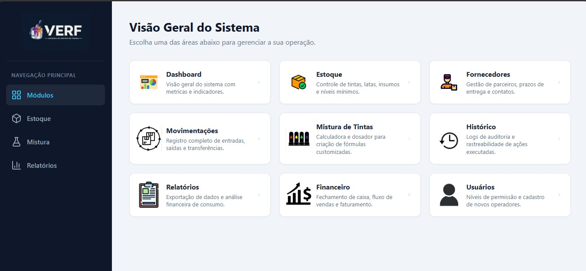

# VERF System


Sistema web para controle de estoque, receitas e produção de tintas, com rastreabilidade das movimentações.

Projeto acadêmico (Projeto Integrador), composto por uma API REST em Spring Boot e um frontend em HTML, CSS e JavaScript puro, servido pela própria API. Este README descreve o que existe hoje no código.

---

## Sumário

- [O problema](#o-problema)
- [Funcionalidades](#funcionalidades)
- [Como executar](#como-executar)
- [Telas](#telas)
- [Regras de negócio](#regras-de-negócio)
- [Segurança e níveis de acesso](#segurança-e-níveis-de-acesso)
- [API](#api)
- [Arquitetura](#arquitetura)
- [Banco de dados](#banco-de-dados)
- [Testes](#testes)
- [Limitações conhecidas](#limitações-conhecidas)
- [Próximos passos](#próximos-passos)
- [Equipe](#equipe)
- [Convenções do repositório](#convenções-do-repositório)
- [Licença](#licença)

---

## O problema

Em uma fábrica ou distribuidora de tintas, o controle costuma ser feito em planilha ou no papel. O resultado é sempre o mesmo: ninguém sabe ao certo quanto existe de cada tinta, quem movimentou o quê, qual receita gerou determinada produção, nem quanto se perdeu no caminho.

O VERF centraliza esses registros em um banco único e guarda o histórico de cada operação. A regra central é que **o saldo de estoque não é editado diretamente**: ele muda apenas como consequência de uma movimentação, e cada movimentação registra quem a fez, quando, por quê e de qual produção veio.

---

## Funcionalidades

- **Autenticação** com JWT e senhas criptografadas com BCrypt, com quatro níveis de acesso
- **Fornecedores:** cadastro, edição, exclusão e busca
- **Usuários (funcionários):** cadastro, edição, exclusão e busca
- **Tintas:** cadastro de tintas compradas ou produzidas; o estoque de cada tinta é criado junto com ela
- **Estoque:** saldo e situação de cada tinta (normal, baixo ou sem estoque)
- **Movimentações:** entradas e saídas com motivo, saldo anterior e posterior e responsável
- **Mistura de tintas:** simulador de cores com prévia ao vivo, receitas e dosador de produção
- **Produção:** consome os ingredientes do estoque e dá entrada na tinta produzida, em uma única transação
- **Dashboard:** indicadores, gráfico mensal, alertas de estoque baixo e exportação do estoque em CSV
- **Relatórios:** consumo por período, ranking de tintas e exportação em PDF
- **Financeiro:** fechamentos com faturamento, compras, perdas e saldo líquido
- **Histórico:** linha do tempo das ações e log das tentativas de login

---

## Como executar

**Pré-requisitos:** Java 21, PostgreSQL e Git. O Maven não precisa estar instalado, pois o projeto usa o wrapper.

**1. Clone o repositório**

```bash
git clone https://github.com/JoaoVieiraL/verf-system.git
cd verf-system
```

**2. Crie o banco no PostgreSQL**

```sql
CREATE DATABASE "dbVerf";
```

Só o banco precisa ser criado: as tabelas são geradas pelo Hibernate na primeira execução (`ddl-auto: update`). A URL está fixa no `application.yaml` como `jdbc:postgresql://localhost:5432/dbVerf`. Para usar outro host, porta ou nome de banco, é preciso alterar o arquivo.

**3. Defina as variáveis de ambiente e execute**

O projeto **não lê arquivo `.env`**. O `.env.example` serve apenas como referência dos nomes: as variáveis precisam ser definidas no terminal ou na run configuration da IDE.

| Variável | Descrição |
|---|---|
| `DATABASE_USERNAME` | Usuário do PostgreSQL |
| `DATABASE_PASSWORD` | Senha do PostgreSQL |
| `JWT_SECRET` | Chave usada para assinar os tokens de login (use um texto longo e aleatório) |

Windows (PowerShell):

```powershell
$env:DATABASE_USERNAME="postgres"; $env:DATABASE_PASSWORD="sua_senha"; $env:JWT_SECRET="uma_chave_aleatoria_longa"; .\mvnw.cmd spring-boot:run
```

Linux e macOS:

```bash
export DATABASE_USERNAME=postgres DATABASE_PASSWORD=sua_senha JWT_SECRET=uma_chave_aleatoria_longa
./mvnw spring-boot:run
```

O sistema sobe em `http://localhost:8090`.

**4. Crie o primeiro usuário**

O banco começa vazio, sem nenhum usuário. Com a API rodando, crie um administrador pela rota de registro:

```powershell
Invoke-RestMethod -Method Post -Uri http://localhost:8090/auth/registro -ContentType "application/json; charset=utf-8" -Body '{"nome":"Administrador","email":"admin@verf.com","senha":"troque-esta-senha","cargo":"TI","nivelDeAcesso":"ADMIN"}'
```

- `senha`: mínimo de 8 caracteres
- `cargo`: `TI`, `DIRETOR`, `OPERADOR` ou `MANUTENCAO`
- `nivelDeAcesso`: `ADMIN`, `GERENTE`, `OPERADOR` ou `VISUALIZADOR`

**5. Acesse**

- Sistema: `http://localhost:8090/index.html`
- Swagger UI: `http://localhost:8090/swagger-ui/index.html`
- Especificação OpenAPI: `http://localhost:8090/v3/api-docs`

---

## Telas

O frontend fica em `frontend/` e é servido pela própria API, sem servidor separado. Depois do login, o token é guardado no navegador e enviado em cada requisição. As páginas restritas redirecionam para o login quando não há sessão.

| Tela | Arquivo | O que faz |
|---|---|---|
| Login | `index.html` | Autenticação |
| Módulos | `modulos.html` | Menu com todos os módulos |
| Dashboard | `dashboard.html` | Cards, gráfico mensal, alertas, últimas movimentações, indicadores e exportação do estoque em CSV |
| Estoque | `estoque.html` | Saldo de cada tinta, cadastro de nova tinta e registro de movimentação |
| Fornecedores | `fornecedores.html` | Cadastro, edição e exclusão |
| Movimentações | `movimentacoes.html` | Histórico completo com filtros e registro de nova movimentação |
| Mistura de Tintas | `mistura.html` | Simulador de cores, receitas e dosador de produção |
| Histórico | `historico.html` | Linha do tempo das ações e log de acessos |
| Relatórios | `relatorios.html` | Consumo por período, ranking de tintas e exportação em PDF |
| Financeiro | `financeiro.html` | Fechamentos e totais |
| Usuários | `usuarios.html` | Cadastro, edição e exclusão |

**Simulador de mistura.** O usuário escolhe de 2 a 5 tintas, ajusta a quantidade de cada uma e vê a cor resultante na hora. Um clique em "Salvar receita" cria a tinta com essa cor, a receita e os ingredientes. A cor é uma aproximação feita no navegador (média geométrica ponderada dos canais combinada com a média simples, para imitar pigmento), não um cálculo espectral.

**Exportar PDF.** O botão da tela de Relatórios abre a impressão do navegador com um layout próprio, onde é possível escolher "Salvar como PDF".



---

## Regras de negócio

**Estoque e movimentações**

- O estoque de uma tinta é criado automaticamente, com saldo 0, quando a tinta é cadastrada
- Não existem rotas para criar, editar ou excluir estoque: o saldo só muda por movimentação
- O saldo anterior e o posterior são calculados pelo servidor, e o responsável é o usuário logado
- Uma saída não pode ser maior que o saldo disponível
- `AJUSTE` exige nível GERENTE e uma justificativa no campo `observacao`
- `FABRICADA` e `CONSUMIDA` são geradas apenas pela produção, nunca manualmente
- O motivo precisa ser compatível com o tipo: `COMPRA` e `FABRICADA` são entradas; `VENDA`, `PERDA`, `DANO` e `CONSUMIDA` são saídas; `AJUSTE` aceita os dois

**Receitas e produção**

- A soma das proporções dos ingredientes não pode passar de 100%, e a produção exige exatamente 100%
- A tinta resultante não pode ser ingrediente da própria receita, e o mesmo ingrediente não pode se repetir
- Uma receita já usada em produção não pode ter ingredientes adicionados
- A produção calcula o consumo como `proporção × volume ÷ 100` (em mL), confere o estoque de cada ingrediente e registra as movimentações na mesma transação

**Tintas**

- Código e cor hexadecimal são únicos
- Tinta comprada exige fornecedor, e tinta produzida não pode ter fornecedor

**Exclusões**

- Fornecedor com tintas vinculadas não pode ser excluído
- Funcionário com registros vinculados não pode ser excluído
- Um usuário não pode excluir ou inativar a si mesmo, nem alterar o próprio nível de acesso

---

## Segurança e níveis de acesso

O login (`POST /auth/login`) devolve um token JWT válido por 2 horas, que deve ser enviado no cabeçalho `Authorization: Bearer <token>`. Rotas sem regra definida são negadas por padrão. Cada tentativa de login, com ou sem sucesso, é gravada em `tb_log_acessos` com e-mail, IP e data/hora.

Os níveis são cumulativos: cada um inclui as permissões dos níveis abaixo.

| Nível | Pode |
|---|---|
| `VISUALIZADOR` | Consultar (`GET`) os dados, exceto os restritos abaixo |
| `OPERADOR` | Também registrar movimentações e produções |
| `GERENTE` | Também gerenciar fornecedores, tintas, receitas e financeiro (inclusive a consulta), e fazer ajustes de estoque |
| `ADMIN` | Também gerenciar funcionários e usuários, e consultar o log de acessos |

---

## API

Base: `http://localhost:8090`. As respostas de erro seguem o formato `{ "mensagem": "...", "status": 400 }`.

| Recurso | Rota | Métodos |
|---|---|---|
| Autenticação | `/auth/login`, `/auth/registro` | `POST` |
| Fornecedores | `/v1/fornecedores` | `GET`, `POST`, `PUT /{id}`, `DELETE /{id}` |
| Funcionários | `/v1/funcionarios` | `GET`, `POST`, `PUT /{id}`, `DELETE /{id}` |
| Usuários | `/v1/usuarios` | `GET`, `POST`, `DELETE /{id}` (inativa) |
| Tintas | `/v1/tintas` | `GET`, `POST` |
| Estoque | `/v1/estoques` | `GET` |
| Movimentações | `/v1/movimentacao-estoque` | `GET`, `POST` |
| Receitas | `/v1/receitas` | `GET`, `POST` |
| Itens de receita | `/v1/itens-receita` | `GET`, `POST` |
| Produções | `/v1/producoes` | `GET`, `POST` |
| Financeiro | `/v1/financeiro` | `GET`, `POST` |
| Log de acessos | `/v1/log-acessos` | `GET`, `POST` |

Todos os recursos com `GET` também aceitam `GET /{id}`. Os detalhes de cada rota e os corpos das requisições estão no Swagger.

**Exemplo:** registrar uma movimentação (`POST /v1/movimentacao-estoque`)

```json
{
  "idEstoque": 1,
  "tipoMovimentacao": "ENTRADA",
  "motivo": "COMPRA",
  "quantidadeMovimentada": 100,
  "observacao": "Compra inicial"
}
```

---

## Arquitetura

```text
Frontend (HTML/CSS/JS)  →  chama a API com fetch e o token JWT
    ↓
SecurityFilter          →  valida o token e carrega o usuário
    ↓
Controller              →  recebe a requisição e valida o DTO (@Valid)
    ↓
Service                 →  aplica as regras de negócio
    ↓
Repository              →  Spring Data JPA
    ↓
PostgreSQL
```

- **Injeção por construtor**, com `@RequiredArgsConstructor` do Lombok
- **DTOs de entrada e de saída**: as entidades JPA não são expostas e a senha nunca é devolvida
- **Erros centralizados** no `GlobalExceptionHandler` (`@RestControllerAdvice`)
- **Transações** (`@Transactional`) nas operações que alteram mais de um registro, como movimentação e produção
- **Auditoria automática**: `criadoEm` e `atualizadoEm` são preenchidos por `@PrePersist` e `@PreUpdate`

### Estrutura de pastas

```text
verf-system/
├── frontend/                       # telas, app.js, styles.css e imagens
├── src/
│   ├── main/
│   │   ├── java/com/verf_system/verfS/
│   │   │   ├── VerfSApplication.java
│   │   │   ├── configuration/      # SecurityConfig, SecurityFilter e TokenService
│   │   │   ├── controller/         # REST controllers
│   │   │   ├── database/
│   │   │   │   ├── entity/         # entidades JPA e enums
│   │   │   │   └── repository/     # interfaces JpaRepository
│   │   │   ├── dto/
│   │   │   │   ├── request/        # DTOs de entrada
│   │   │   │   └── response/       # DTOs de saída
│   │   │   ├── exception/          # exceções de domínio
│   │   │   ├── handler/            # GlobalExceptionHandler
│   │   │   └── service/            # regras de negócio
│   │   └── resources/
│   │       └── application.yaml
│   └── test/
├── .env.example
├── pom.xml
├── README.md
└── ROADMAP.md
```

### Tecnologias

| | |
|---|---|
| Linguagem | Java 21 |
| Framework | Spring Boot 4.0.8 |
| Web | Spring Web MVC |
| Persistência | Spring Data JPA / Hibernate |
| Banco | PostgreSQL |
| Validação | Bean Validation |
| Segurança | Spring Security, JWT (`java-jwt`) e BCrypt |
| Documentação | springdoc-openapi 3.1.0 |
| Frontend | HTML, CSS e JavaScript puro, com ícones Lucide |
| Utilitários | Lombok, Spring Boot DevTools |
| Build | Maven, com wrapper `mvnw` |

---

## Banco de dados

PostgreSQL, com o schema gerado pelo Hibernate (`ddl-auto: update`). Não há migrations (Flyway ou Liquibase).

Tabelas: `tb_fornecedor`, `tb_tinta`, `tb_estoque`, `tb_movimentacao`, `tb_receita`, `tb_itens_receita`, `tb_producoes`, `tb_funcionario`, `tb_usuario`, `tb_log_acessos`, `tb_financeiro`.

```text
Fornecedor   1 ──── N  Tinta
Tinta        1 ──── 1  Estoque
Tinta        1 ──── N  Receita           (tinta resultante)
Receita      1 ──── N  ItensReceita
ItensReceita N ──── 1  Tinta             (matéria-prima)
Receita      1 ──── N  Producoes
Producoes    N ──── 1  Funcionario
Estoque      1 ──── N  Movimentacao
Movimentacao N ──── 1  Funcionario
Movimentacao N ──── 1  Producoes         (opcional)
Funcionario  1 ──── 1  Usuario
Usuario      1 ──── N  LogAcessos
```

### Atualizando um banco antigo

O `ddl-auto: update` só adiciona tabelas e colunas: ele não altera tipos nem remove colunas e regras antigas. **Um banco novo não precisa de nada disso.** Em um banco criado com versões anteriores do código, estes erros podem aparecer:

| Erro | Correção |
|---|---|
| `invalid input syntax for type smallint: "COMPRADA"` | Converter a coluna `origem_tinta` |
| `operator does not exist: character varying >= integer` no log, ao subir a API | Converter a coluna `tipo_movimentacao` |
| `null value in column "atualizado" of relation "tb_estoque"` | Remover as colunas antigas de `tb_estoque` |
| `duplicate key` em `proporcao_percentual` | Remover a regra única antiga de `tb_itens_receita` |

```sql
-- Coluna origem_tinta (número para texto)
ALTER TABLE tb_tinta DROP CONSTRAINT IF EXISTS tb_tinta_origem_tinta_check;
ALTER TABLE tb_tinta
  ALTER COLUMN origem_tinta TYPE varchar(30)
  USING (CASE origem_tinta WHEN 0 THEN 'COMPRADA' WHEN 1 THEN 'PRODUZIDA' END);

-- Coluna tipo_movimentacao (número para texto)
ALTER TABLE tb_movimentacao DROP CONSTRAINT IF EXISTS tb_movimentacao_tipo_movimentacao_check;
ALTER TABLE tb_movimentacao
  ALTER COLUMN tipo_movimentacao TYPE varchar(30)
  USING (CASE tipo_movimentacao WHEN 0 THEN 'ENTRADA' WHEN 1 THEN 'SAIDA' END);

-- Colunas antigas de tb_estoque (confira os nomes no seu banco antes de remover)
ALTER TABLE tb_estoque DROP COLUMN IF EXISTS atualizado;
ALTER TABLE tb_estoque DROP COLUMN IF EXISTS criado;

-- Regra única antiga na proporção
ALTER TABLE tb_itens_receita DROP CONSTRAINT IF EXISTS uksg66js0s1fua7galxgabpuav0;
```

Rode cada bloco apenas se o erro correspondente aparecer: as conversões falham se a coluna já for texto.

---

## Testes

Existe apenas a classe `VerfSApplicationTests`, com o teste `contextLoads`, que verifica se a aplicação sobe. Ele exige um PostgreSQL disponível e as variáveis de ambiente definidas, já que usa o mesmo banco da aplicação. As regras de negócio ainda não têm testes automatizados.

---

## Limitações conhecidas

- **`/auth/registro` é pública:** qualquer pessoa pode criar um usuário, inclusive ADMIN. A rota é temporária e hoje é ela que cria o primeiro usuário. Não exponha o sistema na internet neste estado
- **"Esqueci a senha" não funciona:** a tela chama `/api/auth/esqueci-senha`, rota que não existe no backend
- **Endereço fixo no login:** o `login.js` usa `http://localhost:8090/auth/login`, e precisa ser ajustado para rodar em outro endereço
- **Testes:** só existe o teste de inicialização
- **Listagens sem paginação:** as telas carregam todos os registros de uma vez
- **`frontend/app.js` concentra a lógica de quase todas as telas** em um único arquivo
- **Sem migrations:** alterações de schema em bancos existentes são manuais (veja [Atualizando um banco antigo](#atualizando-um-banco-antigo))
- **Salvar a mesma mistura duas vezes** no simulador cria uma receita repetida

---

## Próximos passos

1. Proteger o `/auth/registro` e criar o primeiro administrador de outra forma
2. Implementar a recuperação de senha
3. Escrever testes de service e controller, principalmente de estoque e produção
4. Adotar Flyway para controlar as alterações no banco
5. Adicionar paginação às listagens
6. Dividir o `app.js` em um arquivo por tela

O [ROADMAP.md](ROADMAP.md) registra o planejamento técnico original do projeto; parte dos itens já foi concluída.

---

## Equipe

| Integrante                                                 | Responsabilidade                             |
|------------------------------------------------------------|----------------------------------------------|
| [João Antonio Vieira Lima](https://github.com/JoaoVieiraL) | Backend — modelagem, API e regras de negócio |
| *Alison Mariano*                                           | *Backend — modelagem, API e regras de negócio* |
| Renan Miranda                                              | Frontend — interface e integração            |
| *Daniel Caitano*                                           | *Frontend — interface e integração*          |
| *Ricardo Jhony*                                            | *Frontend — interface e integração*          |

---

## Convenções do repositório

Os commits seguem o padrão [Conventional Commits](https://www.conventionalcommits.org/pt-br/), com escopo indicando a parte do projeto:

```text
fix(backend): preencher datas de auditoria via callbacks JPA
refactor(backend): padronizar o tipo das chaves primárias como Long
feat(frontend): ajusta ícone do estoque e estilos da sidebar
chore(backend): remover código morto da classe principal
```

Tipos em uso: `feat`, `fix`, `refactor`, `chore`, `docs`, `test`, `style`.

O trabalho acontece diretamente na branch `main`, com os integrantes sincronizando por `pull` antes de cada sessão.

O acompanhamento das tarefas é feito no Jira, com um épico por bloco do roadmap.

---

## Licença

Distribuído sob a licença MIT. Veja o arquivo [LICENSE](LICENSE).

Projeto desenvolvido para fins acadêmicos, como Projeto Integrador.
